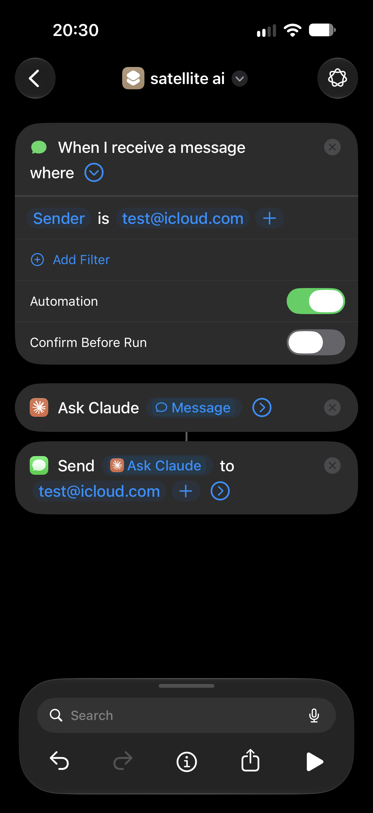

# Satellite AI

A concept for reaching an AI model from anywhere with a clear view of the sky, using the iPhone's satellite texting.

## Background

During a five-week road trip to the west coast, I spent longer without cell service than I ever had before. For several days at a time, coverage was spotty at best and only occasionally strong enough to send a text. It made me realize how much we rely on a constant connection.

That trip was also the first time I used Apple's Messages via satellite. With a clear view of the sky, it worked far better than I expected, and it became my main way of keeping friends and family updated on where I was.

That gave me the idea for this project. If an iPhone can send and receive texts over satellite, then those texts can be answered by an AI. With a small relay set up at home, you can ask an AI questions even when you're completely off-grid.

## How It Works

The setup uses two iPhones:

- **Field phone:** the iPhone you bring with you off-grid. It sends questions over satellite.
- **Relay phone:** a second iPhone left at home with an internet connection. It receives the questions and answers them.

The relay phone runs an Apple Shortcuts automation that:

1. Catches the incoming message from the field phone
2. Sends it to an AI model
3. Sends the AI's reply back to the field phone

From the field phone, it works like texting any other contact.

## Requirements

### Field phone

- iPhone 14 or newer with Messages via satellite
- A recent iOS version
- Located in a country where the feature is offered

When you're out of coverage, the satellite interface appears in Messages, and you text the relay phone your question like any other message.

About iPhone satellite messaging

- Available on iPhone 14 and newer
- Requires a recent iOS version
- Only offered in supported countries
- Works when you're outside cellular and Wi-Fi coverage and have a clear view of the sky
- Messages take longer to send than regular texts, so short messages work best

### Relay phone

- Any spare iPhone that can run Shortcut automations
- Its own Apple Account (free), so the two phones can text each other
- Left at home, plugged in and connected to Wi-Fi

The relay phone does not need to be awake. The automation runs in the background when a message arrives.

## Setup

1. On the relay phone, open the template shortcut: [Get the Satellite AI Shortcut](https://www.icloud.com/shortcuts/c1e7b92d98e847148b42ebc46584f04e)
2. Tap **Add Shortcut**.
3. Replace the placeholder address `test@icloud.com` with the field phone's phone number or Apple Account email. It appears in two places: the **Sender** filter in the trigger, and the recipient in the **Send** action.
4. Make sure **Automation** is on and **Confirm Before Run** is off, so the shortcut runs without needing a tap.

  

### AI model

The **Ask Claude** action comes from the Claude app, which must be installed and signed in on the relay phone. You can swap it for another AI action, such as Apple Intelligence's **Use Model** or **Ask ChatGPT**.

## Notes

- **Keep replies short.** Satellite messages are slow and work best when they're short. Add a prompt to the AI action such as "Answer in under 300 characters, plain text, no formatting."
- **Cost.** Apple has offered satellite features free on supported iPhones for a limited period. On the AI side, Apple Intelligence's models and the free tiers of the Claude and ChatGPT integrations keep the setup free to run.

## Future Ideas

- Commands for real-time weather data
- Commands for translations

## Disclaimer

*This is an experimental, unofficial setup and is not affiliated with Apple. Do not rely on it in an emergency. In an emergency, use Emergency SOS via satellite or contact emergency services directly. Satellite feature availability depends on device, iOS version, country, and carrier.*
