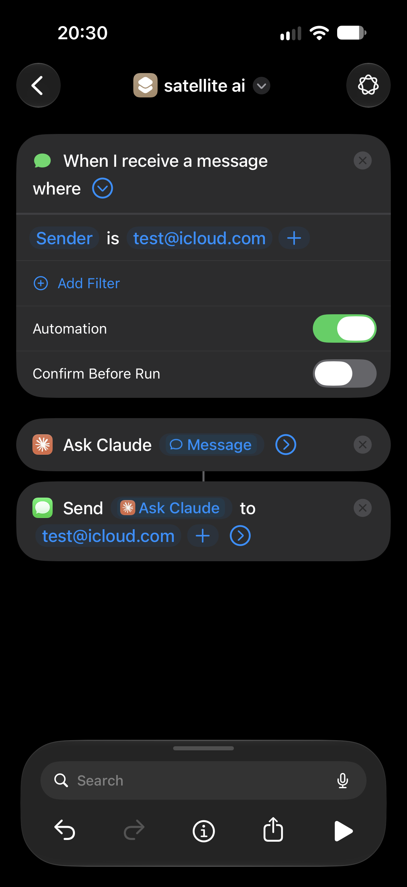

# Satellite AI

**Use an AI assistant from anywhere there's open sky, even with no cell service and no Wi-Fi, using iPhone's satellite texting and a second iPhone as a relay.**

> This is a concept writeup. It explains how the pieces fit together, not a polished step-by-step tutorial.

---

## The idea

iPhones with satellite messaging can send and receive texts (iMessage/SMS) with no cellular or Wi-Fi signal. They can't browse the web or open an AI app over satellite. They can only send text messages.

The trick is to **text a second iPhone that does have internet**. That phone uses an **Apple Shortcuts automation** to:

1. catch the incoming message,
2. send it to an AI model,
3. text the AI's reply back.

The reply goes back over satellite, so you get answers from an AI on a mountain, at sea, or in the backcountry.

```
 ┌──────────────────┐   satellite text   ┌──────────────────┐    internet    ┌──────────┐
 │  iPhone #1       │ ─────────────────▶ │  iPhone #2       │ ─────────────▶ │    AI    │
 │  "Field phone"   │                    │  "Relay phone"   │                │  model   │
 │  (off-grid, uses │ ◀───────────────── │  (at home, on    │ ◀───────────── │          │
 │   satellite)     │   satellite text   │   Wi-Fi, runs    │    response    └──────────┘
 └──────────────────┘                    │   a Shortcut)    │
                                         └──────────────────┘
```

---

## What you need

| Item | Requirement |
|---|---|
| **Field phone** | An iPhone with Messages via satellite (iPhone 14 or newer, on a recent iOS version, in a country where the feature is offered) |
| **Relay phone** | Any second iPhone that can run Shortcuts automations. It needs its **own phone number or Apple Account** so the two phones can text each other |
| **Power + internet for the relay** | The relay phone stays at home, plugged in and on Wi-Fi/cellular, 24/7 |
| **An AI source** | The template uses the Claude app's *Ask Claude* Shortcuts action. Apple Intelligence's *Use Model* or the ChatGPT integration also work |

---

## How it works

### 1. Field phone (sending)
When you're out of coverage, the satellite UI appears in Messages. You text the relay phone a question, like any other text:

> *"What's the boiling point of water at 10,000 ft?"*

### 2. Relay phone (the Shortcut automation)

> **Template Shortcut:** [Get the Satellite AI Shortcut](https://www.icloud.com/shortcuts/c1e7b92d98e847148b42ebc46584f04e)
>
> Open this link on the **relay phone** and tap **Add Shortcut**. Then change the placeholder address `test@icloud.com` to the field phone's phone number or Apple Account email.

<p align="center">
  
</p>

The automation has three parts:

| Step | Action | Setting |
|---|---|---|
| **Trigger** | *When I receive a message* | Filter **Sender is** the field phone's address. Turn **Automation** on and **Confirm Before Run** off so it runs hands-free |
| **1** | *Ask Claude* | Input: the received **Message** |
| **2** | *Send Message* | Send the **Ask Claude** result to the field phone's address |

The *Ask Claude* action comes from the Claude app, which must be installed and signed in on the relay phone. You can swap it for another AI action, such as Apple Intelligence's *Use Model* or *Ask ChatGPT*.

### 3. Field phone (receiving)
The AI's answer comes back over satellite as a normal text.

---

## Tips & gotchas

- **Keep replies short.** Satellite messages are slow and work best when short. Add an instruction to your prompt such as *"Answer in under 300 characters, plain text, no formatting."*
- **Filter by sender.** Only trigger the automation on messages from the field phone. Otherwise every text the relay receives goes to the AI, and you could get an infinite reply loop.
- **Latency.** Expect anywhere from tens of seconds to a few minutes per round trip. You need a clear view of the sky, and you may have to point the phone toward the satellite.
- **The relay must stay online.** If it loses power, Wi-Fi, or gets restarted and locked, nothing answers. Keep it charging, and consider turning off Low Power Mode.
- **No memory by default.** Each message is a new conversation. To give it context you could have the Shortcut save recent messages to a note or file and include them in the prompt.
- **Add commands.** You can branch on keywords (`weather:`, `translate:`, `summarize:`) to run different prompts or actions.

---

## Is it really free?

- **Satellite texting:** Apple has offered satellite features free on supported iPhones for a limited period. Check Apple's current terms for your device and region.
- **AI:** The *Ask Claude* action uses your Claude account, so it falls under that account's plan and usage limits. Apple Intelligence's models and the ChatGPT integration's free tier cost nothing.
- **Relay phone:** An old spare iPhone works. It needs a way to receive messages (its own number or Apple Account).

---

## Disclaimer

This is an experimental, unofficial setup and is not affiliated with Apple. **Do not rely on it in an emergency.** In an emergency, use **Emergency SOS via satellite** or contact emergency services directly. Satellite feature availability depends on device, iOS version, country, and carrier.
